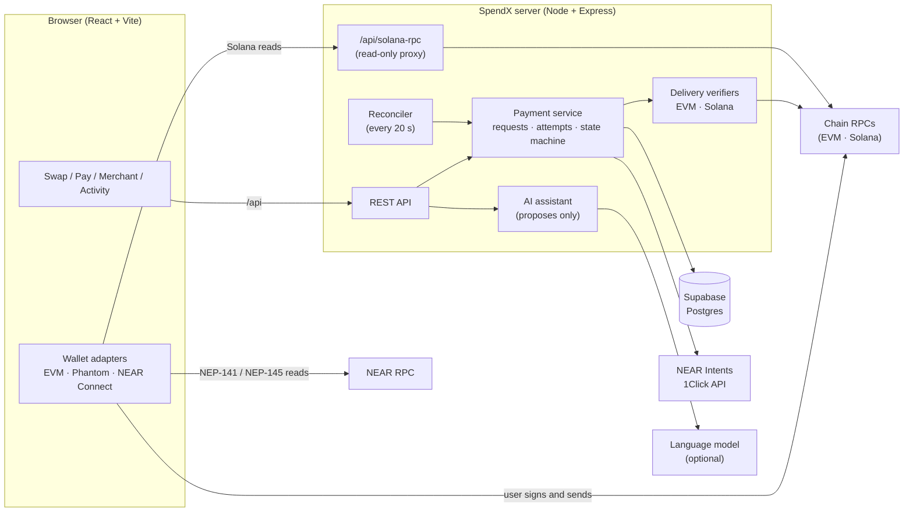

# SpendX

**Pay on any chain with any token.** SpendX is a cross-chain payment and swap layer built on **NEAR Intents**.
A merchant asks for an exact amount of a token on a chain of their choice. A customer pays from whatever token
and chain they already hold. NEAR Intents routes and settles the transfer, and SpendX tracks it to delivery and,
where it can, checks that delivery on the destination chain itself.

> **Status: hackathon build (NEAR HACKATHON 2026).** This README describes what the code does today.
> Rows marked *not yet implemented* or *not yet tested with real funds* are exactly that.

---

## Contents

1. [What SpendX is](#what-spendx-is)
2. [The problem](#the-problem)
3. [How a payment works](#how-a-payment-works)
4. [Architecture](#architecture)
5. [NEAR technologies used, and how](#near-technologies-used-and-how)
6. [Safety design](#safety-design)
7. [What works today](#what-works-today)
8. [Run it locally](#run-it-locally)
9. [Configuration](#configuration)
10. [Deploying (Render and Vercel)](#deploying-render-and-vercel)
11. [Testing instructions](#testing-instructions)
12. [Project layout](#project-layout)
13. [Hackathon disclosure](#hackathon-disclosure)

---

## What SpendX is

SpendX has three connected parts:

- **Payment requests (merchant side).** A merchant signs in with a wallet and creates a request: *"I want exactly 25 USDC on Base, sent to this address."*
  They get a shareable link (`/#/pay/<slug>`) and a dashboard that shows each request's status.
- **Pay with anything (customer side).** The customer opens the link, connects a wallet, and picks any source network and token from the live NEAR Intents catalog.
  SpendX gets a quote that delivers the **exact** amount the merchant asked for, shows the cost, and asks the customer to approve one transfer from their own wallet.
- **One-click Swap.** The same machinery for personal use: send an exact amount of one token, receive another token on any chain, delivered to your own address.
  An optional **AI assistant** turns a sentence such as "10 SOL to USDC on Base" into a pre-filled swap card for review. It only proposes; it can never sign or send.

SpendX never holds keys and never holds funds. Every transfer is signed by the customer in their own wallet,
and the money moves through NEAR Intents' deposit addresses, not through a SpendX account.

## The problem

Getting paid on a specific chain, in a specific token, normally forces the payer to do the work:
swap into the right token, bridge to the right chain, maybe swap again, then send, with a different wallet, fee and failure mode at each step.
Merchants either accept only what is convenient for them (and lose customers) or reconcile a mess of partial and misrouted payments.

SpendX collapses that into one step for the customer and one guarantee for the merchant:

- The **customer** chooses what they hold and approves a single transfer.
- The **merchant** receives *exactly* the requested amount, in the requested token, on the requested chain.
- If the cross-chain swap fails, NEAR Intents **refunds the customer** to their own address, and SpendX shows the refund.
- A payment is only shown as **confirmed after delivery is confirmed**, not when the customer clicks send.

## How a payment works

1. **Request.** The merchant creates a request: amount, destination token and chain, recipient address. It is stored with a unique link.
2. **Choose.** The customer opens the link and picks a source token and chain from the live catalog. Whether a pair is routable is decided by a live quote, never assumed.
3. **Preview.** SpendX asks 1Click for a **dry** quote (`dry: true`, `swapType: EXACT_OUTPUT`, `depositType: ORIGIN_CHAIN`). A dry quote can never create a deposit address, so previews are free and safe.
4. **Final quote.** When the customer continues, SpendX requests a **live** quote and checks it before showing anything (see [Safety design](#safety-design)).
5. **Pay.** The customer approves one transfer from their own wallet to the quote's deposit address.
6. **Track.** SpendX polls the 1Click status API and, for supported destination chains, reads the destination chain directly to confirm the recipient received at least the promised amount.
7. **Settle or refund.** On success the request shows **Verified on-chain** (or **Delivery reported by NEAR Intents** where SpendX cannot check the chain). On failure the refund is shown.

Nothing is hardcoded to specific chains or tokens. Selectors are built from the 1Click token catalog.

## Architecture



### How the pieces fit

| Layer | Where | Responsibility |
| --- | --- | --- |
| **Web app** | `web/` | React single-page app. Hash routes (`#/swap`, `#/pay/<slug>`, `#/payments`, `#/activity`, `#/merchant`), live catalog selectors, quote previews, wallet connection, review and status screens. Reads balances from the customer's own wallet in the browser. |
| **Wallet adapters** | `web/src/wallets/` | One adapter per wallet family behind a common interface (connect, balance, sign message, send deposit). EVM (EIP-6963), Solana (Phantom), NEAR (NEAR Connect). |
| **Server** | `server/` | Express API, payment service, 1Click client, quote validation, delivery verifiers, reconciler, auth, assistant, security headers. |
| **Shared logic** | `shared/` | Pure, testable code used by both sides: address validation, base-unit amounts, the payment state machine, quote validation, deposit classification, NEAR and SPL transaction planning. |
| **Storage** | `supabase/` | Postgres tables `payment_requests` and `payment_attempts`, row level security on, and a unique index that allows only **one live attempt per request**. `REPOSITORY=memory` exists for local development only. |

### Trust boundaries

- **The browser holds no secrets.** It talks to SpendX's own `/api`. Solana reads go through `/api/solana-rpc`, so a private RPC key lives only on the server.
- **The server never holds user keys.** It builds quotes and records state. It cannot move a user's funds.
- **The wallet is the only signer.** Every deposit and every sign-in message is approved by the user in their own wallet.
- **Delivery is confirmed, not assumed.** The payment state machine refuses to show "paid" until delivery is confirmed or honestly labelled as only *reported*.

### Payment state machine

`awaiting_payment → payment_initiated → source_submitted → processing → destination_confirmed`, with the side exits
`incomplete_deposit`, `refunded`, `failed`, `expired`, `cancelled` and `needs_review`.
A 1Click `SUCCESS` is held in `processing` until delivery is verified; if the destination check disagrees (wrong recipient, too little, wrong asset),
the payment becomes `needs_review` and is never shown as paid.

## NEAR technologies used, and how

### 1. NEAR Intents, 1Click Swap API

Base URL `https://1click.chaindefuser.com`. Implemented in `server/src/oneclick.ts` (backend only; the optional partner key goes in the `X-API-Key` header).

| Endpoint | What SpendX uses it for |
| --- | --- |
| `GET /v0/tokens` | Builds the **live catalog**: every network and token in the selectors, price hints, and the decimals used for exact amounts. Look-alike tokens are flagged. |
| `POST /v0/quote` | **Dry quotes** for previews (no deposit address). **Live quotes** for the final step, which return the deposit address and deadline. Payments use `EXACT_OUTPUT` (the merchant gets exactly the amount). Swaps use `EXACT_INPUT` with a guaranteed minimum and slippage between 0.1% and 5%. |
| `POST /v0/deposit/submit` | Tells 1Click the source transaction hash right after the customer sends, as an optional speed-up. 1Click also detects deposits by itself. |
| `GET /v0/status` | Polled to follow the transfer: `PENDING_DEPOSIT`, `KNOWN_DEPOSIT_TX`, `PROCESSING`, `SUCCESS`, `INCOMPLETE_DEPOSIT`, `REFUNDED`, `FAILED`. Mapped to SpendX's payment states. |

Request settings used: `depositType: ORIGIN_CHAIN`, `recipientType: DESTINATION_CHAIN`, `refundType: ORIGIN_CHAIN`, with the payer's address as the refund address.

### 2. Quote signature verification (1Click SDK)

`@defuse-protocol/one-click-sdk-typescript` provides `verifyQuoteSignature`. SpendX runs it on every live quote, on the untouched API response, and refuses unsigned or invalid quotes.

### 3. Live-quote validation (`shared/src/quote-validation.ts`)

Before a deposit address is ever shown, SpendX checks the live quote against the request: swap and deposit types, source and destination asset, recipient, refund address,
exact requested amount, that the quote delivers **at least** the requested amount, that the deposit address and deadline exist, and that the deadline leaves a safe margin. Any mismatch blocks the payment with the reason.

### 4. NEAR Connect and NEP-141 / NEP-145 (paying from a NEAR account)

- **Wallet connection:** `@hot-labs/near-connect` (`web/src/wallets/WalletContext.tsx`), loaded lazily. Users pick HOT, Meteor, Nightly and other NEAR wallets in NEAR Connect's own selector.
- **Token transfer:** NEP-141 `ft_transfer` with exactly 1 yoctoNEAR attached, signed through the wallet's `signAndSendTransaction`.
- **Storage registration:** NEP-145. SpendX reads `storage_balance_of` for the deposit address and, if it is not registered, adds a `storage_deposit` action using `storage_balance_bounds().min` in the same approval (`shared/src/near-deposit.ts`, `web/src/wallets/near.ts`).
- **Reads:** balances and registration status come from NEAR JSON-RPC (default `https://free.rpc.fastnear.com`, override with `VITE_NEAR_RPC_URL`).

### 5. NEAR as a destination

Merchants and swappers can receive on NEAR. Delivery on NEAR cannot be checked independently by SpendX yet, so it is labelled **Delivery reported by NEAR Intents**, with the destination transaction link, never "verified".

### 6. NEAR Intents Explorer and docs

The landing page and status screens link to <https://explorer.near-intents.org> and <https://docs.near-intents.org/>. All numbers on the landing page (network and token counts, the hero quote) come from the live API.

## Safety design

- **Exact amounts, in integers.** Amounts are base-unit integers end to end; there is no floating-point money.
- **Signed and validated quotes.** Signature check plus field-by-field validation of every live quote.
- **One live attempt per request.** A unique database index makes it impossible to open two live payments for one request. If a deposit lands after the deadline, the original attempt is revived instead of opening a second one, so a merchant is never paid twice.
- **No false "paid".** A payment is confirmed only after delivery is verified (EVM, Solana) or honestly labelled as reported (other chains). A mismatch becomes **Needs review**.
- **Independent delivery checks.** The EVM verifier reads ERC-20 `Transfer` logs and native transfers. The Solana verifier reads SOL and SPL token balance changes. Both require the *recipient* to have received *at least* the promised amount, and anything not positively confirmed is never reported as verified.
- **Address checks.** EVM and Solana addresses are validated. For chains without a local validator, the user must explicitly confirm the address.
- **Wallet sign-in is text only.** Merchant sign-in signs a plain message (EVM EIP-191, Solana ed25519). Challenges are single-use and expire after 5 minutes; sessions last 12 hours.
- **The assistant cannot act.** The model only fills a fixed schema. Ordinary code matches tokens against the live catalog, validates amounts and addresses, and reports ambiguity. It has no wallet access, and balance questions are answered from the person's own wallet in the browser, so the model never sees holdings. An address taken from a message is flagged for the user to check.
- **No keys in the browser.** The build fails if `VITE_SOLANA_RPC_URL` looks like it contains a key. The `/api/solana-rpc` proxy allows only the five read calls the app uses, rejects batches, requires a mint filter on token lookups, and is rate limited per client.
- **Hardened server.** Security headers (frame blocking, `nosniff`, no referrer, HSTS in production, CSP in report-only mode until `CSP_ENFORCE=1`), request body limits, and a production check that refuses to start without `SESSION_SECRET`, `PUBLIC_ORIGIN` and a real database.

## What works today

Supported wallet families: **Solana, EVM and NEAR**. Merchants can request payment on **any chain in the live catalog**, since receiving needs only an address.

| Area | State |
| --- | --- |
| 1Click client, dynamic catalog, exact-output and exact-input quotes, live-quote validation, signature check | Implemented. Tokens and dry quotes verified against the live API |
| Payment service (requests, previews, attempts, deposits, status, refunds, expiry, duplicate protection, background reconciler) | Implemented, unit-tested |
| Merchant sign-in by wallet signature (EVM and Solana) | Implemented. Solana tested with real keys; EVM not yet exercised with a real wallet |
| Merchant sign-in with a NEAR wallet (NEP-413) | *Not yet implemented* (sign in with EVM or Solana; you can still receive on NEAR) |
| REST API and Express server | Implemented and deployed (Render API, Vercel site) |
| Web app: landing page, swap workspace, payment screen, wallet modal, review modal, activity, merchant dashboard, live status tracker | Implemented and running in the browser |
| Solana balance and token reads through the server proxy | Implemented and confirmed working in the deployed setup |
| One-click **Swap** (exact input, delivered to your own address) | Implemented end to end; *not yet exercised with real funds* |
| Paying from **EVM wallets**: native and ERC-20 on Ethereum, Base, Arbitrum, Optimism, Polygon, BNB Chain, Avalanche, Gnosis, Scroll | Implemented; *not yet tested with real funds* |
| Paying from **Phantom (Solana)**: native SOL and classic SPL tokens (creates the recipient's token account when missing) | Implemented; *not yet tested with real funds*. Token-2022 mints are refused on purpose (they can carry transfer fees or hooks) |
| Paying from a **NEAR wallet**: NEP-141 tokens, including one-time storage registration | Implemented; adapter logic unit-tested against a fake NEAR RPC; *not yet run with a real wallet or funds* |
| Independent delivery verification on **EVM and Solana** destinations | Implemented; tested against simulated chain responses (correct, wrong recipient, too little, reverted, not yet visible); *not yet run against live chains* |
| Delivery verification for **NEAR** and other destinations | *Not available*: shown as "reported by NEAR Intents" with the transaction link |
| AI assistant (swap sentence to a pre-filled card; balance questions; pasted payment links open directly) | Implemented, unit-tested with simulated replies. Works with Anthropic or any OpenAI-compatible endpoint, with an optional fallback model. Hidden unless a key is set |
| Supabase storage | Required in production (the server refuses `REPOSITORY=memory`). Check a connection with `npm run db:check` |
| Real mainnet payments end to end | Tx Hashs: 5Ni32Q9eHCsBuYgjaKsbs7WLmktg7NECMDegcFJKbsxArNKfdkH9TQPvAtBv3AoVWrrKeena7HADNjXVN6LDqjdJ, 4e6vU6BPBQ1G2Sy85xtJPcDhUAbydYUrKGGqC52EkAxmkSH1QosGZqEwzZRu2D5rwdwNnVwKQHdMZUiU81uDaM6r |

150+ unit tests cover the shared logic, server, and wallet adapters (`npm test`, no network needed).

## Run it locally

Requires **Node.js 22.18 or newer**.

```bash
npm install
cp .env.example .env        # then edit .env (see Configuration)
npm test                    # unit tests, no network needed
```

Two terminals:

```bash
npm start      # API on http://localhost:8787
npm run dev    # web app on http://localhost:5173 (proxies /api to the API)
```

The landing page is the home page (`http://localhost:5173/`); **Launch app** opens the swap at `#/swap`.
For a single-server build, run `npm run build` and then `npm start`; the API serves `web/dist`.

Useful scripts: `npm run typecheck`, `npm run db:check`, `npm run ai:check`, and `npm run discover` to explore the live catalog:

```bash
npm run discover                              # list the live catalog
npm run discover -- --find USDC               # find an asset
npm run discover -- --chain sol               # assets on one chain
npm run discover -- --pair "sol:SOL>base:USDC" --amount 1 --addr "svm=<solana address>,evm=<0x address>"   # dry quote only
```

`discover` only requests **dry** quotes, which can never create a deposit address or move funds.

## Configuration

Copy `.env.example` to `.env`. **Never commit `.env`**, and never put a secret in a `VITE_` variable: those are bundled into public JavaScript.

### Server

| Variable | Required | Purpose |
| --- | --- | --- |
| `SESSION_SECRET` | Yes | At least 32 random characters. Signs sign-in challenges and sessions. |
| `PUBLIC_ORIGIN` | In production | The https address people open SpendX at (no path, no trailing slash). Written into the wallet sign-in message. |
| `SUPABASE_URL`, `SUPABASE_SERVICE_ROLE_KEY` | In production | Database. Run `supabase/migrations/0001_init.sql` first. The service-role key is server only. |
| `REPOSITORY` | No | `memory` for local development only (data resets on restart). Default is Supabase. |
| `SOLANA_RPC_URL` | No | Solana RPC for delivery checks **and** the `/api/solana-rpc` proxy the browser uses. A keyed URL (for example Helius) belongs here, never in a `VITE_` variable. |
| `RPC_URL_<CHAIN>` | No | Per-chain RPC for delivery checks, for example `RPC_URL_BASE`. EVM chains default to viem's public RPC. |
| `ONECLICK_API_KEY` | No | Free from <https://partners.near-intents.org>. Without it an extra 0.25% fee applies to live quotes. |
| `ONECLICK_BASE_URL` | No | Override the 1Click API base URL. |
| `TRUST_PROXY` | Behind a proxy | Number of proxy hops to trust so rate limits see the real client IP (`1` for Render alone, `2` for Vercel in front of Render). |
| `SLIPPAGE_BPS` | No | Default swap slippage in basis points (default 100 = 1%). |
| `QUOTE_DEADLINE_MINUTES` | No | Quote validity window (default 10, range 3 to 60). |
| `RECONCILE_INTERVAL_SECONDS` | No | Background status refresh (default 20; `0` turns it off; minimum 5). |
| `CSP_ENFORCE` | No | Set to `1` to enforce the Content-Security-Policy once the browser console shows no reports. |
| `PORT` | No | Defaults to 8787 locally; hosts such as Render set it for you. |

### Assistant (optional, server side only)

| Variable | Purpose |
| --- | --- |
| `AI_PROVIDER` | `anthropic` or `openai`. If unset, whichever key is present is used (Anthropic first). |
| `ANTHROPIC_API_KEY`, `ANTHROPIC_MODEL` | Anthropic provider. Check the model name against Anthropic's docs. |
| `OPENAI_API_KEY`, `OPENAI_BASE_URL`, `OPENAI_MODEL`, `OPENAI_REASONING_EFFORT` | Any OpenAI-compatible endpoint. |
| `AI_FALLBACK_PROVIDER`, `AI_FALLBACK_API_KEY`, `AI_FALLBACK_BASE_URL`, `AI_FALLBACK_MODEL`, `AI_FALLBACK_REASONING_EFFORT` | Optional second model used if the first fails. |
| `AI_TIMEOUT_MS` | Per-request timeout. |

With no key set, the assistant is simply hidden.

### Web build (public, never secrets)

| Variable | Purpose |
| --- | --- |
| `VITE_SOLANA_RPC_URL` | Optional **key-free** Solana endpoint for the browser. Leave it unset to use the built-in `/api/solana-rpc` proxy. The build fails if the value looks like it contains a key. |
| `VITE_NEAR_RPC_URL` | Optional NEAR RPC override (default `https://free.rpc.fastnear.com`). |

## Deploying (Render and Vercel)

SpendX can run as **one container** (the server serves the API and the built site), which is the simplest route. It also works split:
**Render** runs the API and **Vercel** serves the website, with Vercel forwarding `/api` to Render.

1. **Supabase:** run `supabase/migrations/0001_init.sql` in the SQL editor; note the project URL and service-role key.
2. **Render (API):** New Web Service, **Docker** runtime (the `Dockerfile` builds and runs everything), health check path `/api/health`, a **single instance**. Set the server variables above (`SESSION_SECRET`, `SUPABASE_URL`, `SUPABASE_SERVICE_ROLE_KEY`, `PUBLIC_ORIGIN`, `TRUST_PROXY`, and optionally `SOLANA_RPC_URL`, `ONECLICK_API_KEY` and the assistant keys).
3. **Vercel (site):** import the repo; the root `vercel.json` already sets install, build (`npm run build`) and output (`web/dist`), forwards `/api/*` to your Render service, and adds security headers. Set the destination in `vercel.json` to your Render URL. **No environment variables are needed on Vercel**; do not set `VITE_SOLANA_RPC_URL` with a key. Use Node 22.x.
4. **Finish:** set `PUBLIC_ORIGIN` on Render to the final website address (the Vercel URL or your custom domain) and redeploy.
5. **Check:** `https://<your-render-service>/api/health` returns `{"ok":true}`, and so does `https://<your-site>/api/health` through the rewrite.

Notes: Render's free tier sleeps when idle, which pauses the background reconciler that advances open payments, so use an always-on instance for real payments.
If `npm ci` fails on a lockfile mismatch, regenerate the lockfile with `npx npm@10 install` and commit it.

## Testing instructions

### No funds needed

1. **Connect a wallet.** Open the app, click **Connect wallet**, and pick an EVM wallet, Phantom, or a NEAR wallet.
   *Expected:* a chip with the wallet name and a shortened address.
2. **Sign in as a merchant.** Open **Merchant**, click **Sign in with ...**, and sign the message.
   *Expected:* the wallet shows a plain-text message (no transaction, no fee), then "Signed in as ..." and the create form.
3. **Create a payment link.** Choose a network and token to receive (for example Base and USDC), enter `1`, paste a recipient address, and click **Create payment link**.
   *Expected:* a link with **Copy link** and **Open payment page**, and a new row in the Payments table with "No payment yet".
4. **Preview as a customer.** Open the payment page and choose a network and token to pay with.
   *Expected:* the amount you would pay, estimated fees and delivery time from a live dry quote. Unsupported tokens are greyed out with the reason.
5. **Try the Swap.** Open **Swap**, choose a source and a destination, and enter an amount.
   *Expected:* the **You receive** box fills from a live quote, with rate, guaranteed minimum, cost and time under the card. Changing slippage or amount refreshes it. A warning appears if spread and fees exceed about 3%.
6. **Try the assistant** (needs an AI key). Type `10 SOL to USDC on Base`.
   *Expected:* the card fills in and nothing is sent. Typing `swap some USDC to SOL` returns a question, not a guess. Pasting a SpendX payment link opens it directly.

### Real funds (mainnet, small amounts)

NEAR Intents has **no testnet**, so a real payment uses real tokens. Use about 1 USDC and a recipient address you control.
Not yet recorded end to end; this section will be updated with real transaction hashes.

7. Click **Continue to final quote**. *Expected:* a Final quote card with the exact amount, deposit address, your refund address and a countdown. Nothing is sent yet.
8. Click **Approve in wallet and pay ...** and approve. *Expected:* your wallet shows one transfer to the deposit address, then the status page opens.
9. Watch the status page. *Expected:* steps advance from "Source transaction submitted" to "Processing cross-chain transfer" to "Destination payment confirmed".

### Verify the destination transaction

On the status page, **Source transaction** and **Destination transaction** link to block explorers; open the destination link and confirm the recipient and amount.
The page states how delivery was confirmed:

- **Verified on-chain**: SpendX read the destination chain and saw the recipient receive at least the promised amount.
- **Delivery reported by NEAR Intents**: SpendX cannot check that chain (for example NEAR), so only NEAR Intents' report and the transaction link back it up.
- **Needs review**: a transaction exists but does not match the recipient or amount. It is never shown as paid.

## Project layout

```
shared/    pure logic: addresses, amounts, state machine, quote validation, deposit planning (NEAR, SPL)
server/    Express API, 1Click client, payment service, verifiers, reconciler, auth, assistant, Solana RPC proxy
web/       React + Vite app, wallet adapters (EVM, Phantom, NEAR Connect)
supabase/  database migration
scripts/   discover, db-check, ai-check, assistant-check
Dockerfile one-container build; vercel.json for the split deployment
```

## Network and cost notes

NEAR Intents has no testnet. Real payments mean mainnet with small amounts and gas on the source chain. Dry quotes are free.
The app never signs or sends a transaction without an explicit approval in the user's own wallet.

## Hackathon disclosure

- Built during NEAR HACKATHON (2026-11-01 to 2026-11-14). No pre-hackathon code.
- UI/UX design: supplied by the team as a Figma Make export (a cross-chain transfer interface). Its layout, palette and typography are implemented in plain CSS and React; its placeholder content (mock routes, canned assistant replies and portfolio figures) was deliberately not used.
- Libraries: React, Vite, viem, @solana/web3.js, @hot-labs/near-connect, Express, @supabase/supabase-js, @defuse-protocol/one-click-sdk-typescript. Fonts: DM Sans and Manrope (Google Fonts).
